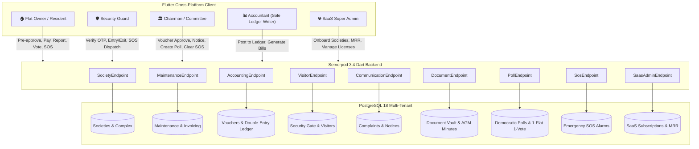

# Multi-Tenant Society Management SaaS Platform

A modern, comprehensive Society Management, Security & Accounting SaaS Platform built with **Flutter** (Cross-Platform Mobile & Web) and **Serverpod** (Dart backend + PostgreSQL 18).

---

## 🏛️ System Architecture



---

## 🎯 Key Roles & Features

| Role | Responsibilities | Key Capabilities |
|---|---|---|
| **🏠 Flat Owner (Resident)** | Apartment Living | View/Pay monthly maintenance dues via UPI, pre-approve visitors/cabs with 4-digit OTPs, gate bell approval, raise complaints, access **Document Vault** (Bye-laws, Audits), participate in **Democratic Polling (1 Flat = 1 Vote)**, trigger instant **Emergency SOS Alarm** (Medical, Fire, Lift Stuck). |
| **🛡️ Security Guard** | Gate & Campus Security | Fast touch UI for check-ins, 4-digit passcode verifier to open gate, live visitor monitoring ("Inside", "Pending", "Expected"), one-tap exit recording, **Live SOS Siren Banner** with "Acknowledge & Dispatch" response. |
| **🏛️ Chairman / Committee** | Society Governance | Society KPI overview (occupancy, collections, complaints), review expense voucher requests, approve/reject vouchers with remarks, broadcast notices, review AGM meeting minutes, clear SOS alarms. |
| **📊 Accountant** | **Sole Authorized Ledger Writer** | Review Chairman-approved vouchers, generate balancing double-entry journal entries (`JE-xxx`), view Real-time General Ledger, issue society maintenance bills, export balance sheets. |
| **🌐 SaaS Super Admin** | Platform Commercials | Multi-society tenant management, track Total Managed Flats & Monthly Recurring Revenue (MRR), manage tiered subscriptions (Starter @ ₹15, Pro @ ₹25, Enterprise @ ₹35/flat/mo), onboard new housing societies. |

---

## 📦 Implemented Modules

1. **Multi-Tenancy & Complex Support:**
   - Isolated society tenants with shared campus/gate support (`complex` table).
2. **Maintenance Billing & Invoicing:**
   - Flexible tariff heads, bill generation, UPI payments, and payment records.
3. **Strict Voucher & Double-Entry Accounting:**
   - Committee requests $\rightarrow$ Chairman approves $\rightarrow$ Accountant executes & posts to General Ledger.
4. **Security Gate & Passcode Management:**
   - Quick 4-digit OTP gate entry, manual registration, resident approval, live campus occupancy.
5. **Complaints Helpdesk & Notice Board:**
   - Ticket lifecycle (Open $\rightarrow$ In-Progress $\rightarrow$ Resolved), urgent circular broadcasting.
6. **📁 Document Vault & Meeting Minutes (MOM):**
   - Official society bye-laws, financial audits, insurance & NOCs, confidential committee vault, and AGM/EGM minutes with quorum & resolution logs.
7. **🗳️ Democratic Polling & Society Resolutions:**
   - Digital voting enforcing **1 Flat = 1 Vote**, real-time percentage progress bars, voter turnout tracking.
8. **🚨 Emergency SOS & Siren Alert:**
   - Instant 1-tap SOS trigger (Medical, Fire, Lift Stuck, Security Threat) alerting Security Gate & Chairman with audio-visual alerts and guard dispatch tracking.
9. **💼 SaaS Super Admin & Subscription Billing:**
   - Multi-society portal tracking Platform MRR, active flat licenses, Starter/Pro/Enterprise tiers, and client onboarding.

---

## 🚀 Running the Project

### 1. Start the Serverpod Backend
Make sure PostgreSQL is running locally:
```bash
cd society_server
dart bin/main.dart --apply-migrations
```
The API server starts on `http://localhost:8080/`.

### 2. Run the Flutter Client
To run on Chrome / Web:
```bash
cd society_flutter
flutter run -d chrome
```
To run on macOS / Desktop:
```bash
flutter run -d macos
```

### 3. Interactive Role Switcher
In the app's top AppBar, use the **Role Switcher Dropdown** to seamlessly test and experience:
1. `🏠 Resident (Flat Owner)`
2. `🛡️ Security Guard`
3. `🏛️ Chairman / Committee`
4. `📊 Accountant (Ledger)`
5. `🌐 SaaS Super Admin`
