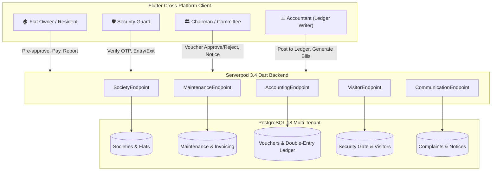

# Multi-Tenant Society Management SaaS Platform

A modern, comprehensive Society Management & Accounting Platform built with **Flutter** (Mobile & Web) and **Serverpod** (Dart backend + PostgreSQL).

---

## 🏛️ System Architecture



---

## 🎯 Key Roles & Workflows

| Role | Responsibilities | Key Capabilities |
|---|---|---|
| **🏠 Flat Owner (Resident)** | Personal apartment management | View/Pay monthly maintenance dues via UPI, pre-approve visitors/cabs with 4-digit OTPs, gate bell approval, raise & track complaints, view society circulars. |
| **🛡️ Security Guard** | Gate & perimeter security | High-contrast touch UI for quick check-ins, instant 4-digit passcode verification to open gate, live visitor monitoring ("Inside", "Pending", "Expected"), one-tap exit recording. |
| **🏛️ Chairman / Committee** | Society governance | High-level KPI overview (occupancy, collections, complaints), review expense voucher requests, approve/reject vouchers with remarks, broadcast urgent notices. |
| **📊 Accountant** | **Sole Authorized Ledger Writer** | Review Chairman-approved vouchers, generate balancing double-entry journal entries (`JE-xxx`), view Real-time General Ledger, issue society maintenance bills, export balance sheets. |

---

## 📁 Repository Structure

```
mobileApp/
├── society_client/          # Generated Dart client library
│   └── lib/
│       └── src/protocol/    # Strongly-typed models & API endpoints
├── society_server/          # Serverpod Dart backend
│   ├── lib/src/
│   │   ├── core/            # Society, Building, Flat, User models & endpoint
│   │   ├── maintenance/     # Billing, Rates, Payment records & endpoint
│   │   ├── accounting/      # Vouchers, Ledger entries & Accountant endpoint
│   │   ├── visitor/         # Security gate, Passcode & Visitor endpoint
│   │   └── communication/   # Notices & Complaints endpoint
│   └── migrations/          # PostgreSQL database schema migrations
└── society_flutter/         # Flutter Client Application (Android / iOS / Web)
    └── lib/
        ├── theme/           # Modern Teal / Slate Navy Material 3 Design
        ├── services/        # SocietyState management & API client bindings
        └── screens/
            ├── dashboard/   # Resident, Guard, Chairman, Accountant views
            └── home_screen.dart # Interactive multi-role switcher & navigation
```

---

## 🚀 Running the Project

### 1. Start the Serverpod Backend
Make sure PostgreSQL is running locally (or use Docker):
```bash
cd society_server
dart bin/main.dart --apply-migrations
```
The API server starts on `http://localhost:8080/`.

### 2. Run the Flutter Client
To run on Chrome / Web:
```bash
cd society_flutter
flutter run -d chrome
```
To run on Android or iOS / macOS:
```bash
flutter run -d macos
# or
flutter run -d <device_id>
```

### 3. Testing Role Switcher
In the app's top AppBar, use the **Role Switcher Dropdown** to seamlessly test and experience:
1. `🏠 Resident (Flat Owner)`
2. `🛡️ Security Guard`
3. `🏛️ Chairman / Committee`
4. `📊 Accountant (Ledger)`
